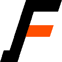

# Ferrilab Logos

- 
- 
- 
- 
- 
- 

The text is oblique, at 18° clockwise from vertical. It is stroked primarily
using lines along the oblique grid, either horizontal or (skewed) vertical, with
few diagonals. Diagonals are 45° (skewed) whenever possible.

Each mark should be stroked in black-on-white or white-on-black, with one
Aerospace Orange (`#ff4f00`) small element, ideally square. Where possible, use
the tittle of an `i` or `j`.

The favicon is a stylized uppercase `F`. It connotes a switch or branch. The
center bar of the `F` is the accented element. The `F` of `Ferrilab`, but not
any other F, may have a left-pointing tail at the base of the stem.

A nearly-square logomark (not suitable for favicon use) may be used for
stationery. It consists of the word “Ferri-Lab!”, with the hyphen replaced by a
line-break. The `i` and `!` are opposed, as are the `F` and `L`.

A prior version of the logo used the Rust chainring to enclose the text “FRB” in
the _Ferro Rosso_ font, above an aerospace-orange voltage transformer.

- <https://github.com/rust-lang/rust-artwork/blob/master/logo/rust-logo-gear-only.svg>
- <https://www.1001fonts.com/ferro-rosso-font.html>
- <https://stackoverflow.com/questions/39256104/how-to-convert-an-image-file-from-svg-to-a-multi-size-ico-without-blur-sharp>

